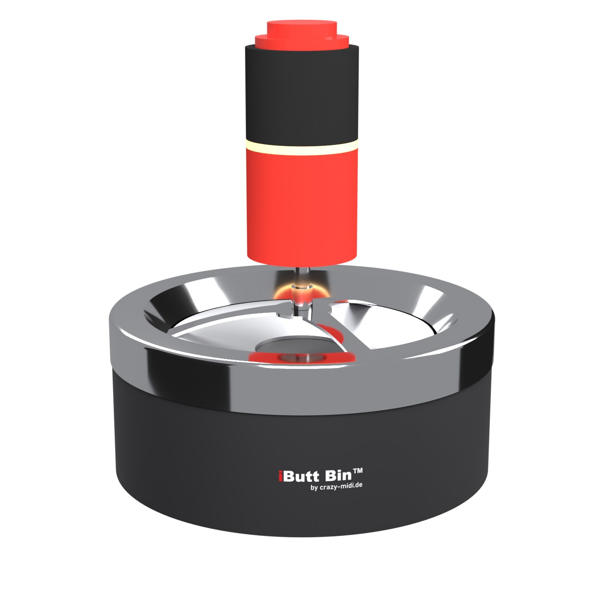
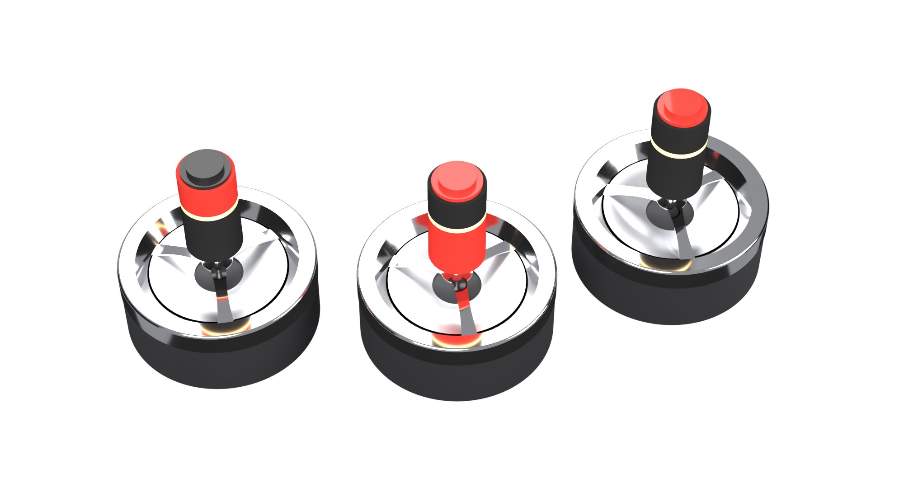
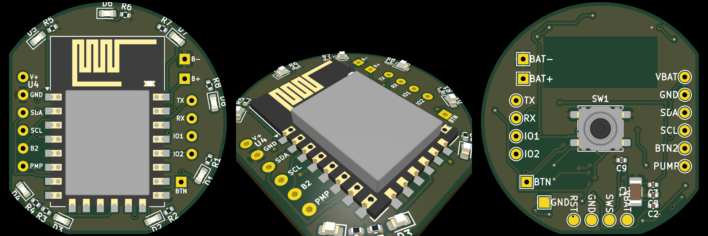

# Ciggie Counter & Butt Bin

Count your cigarettes, see your patterns, pace yourself, without ads, accounts or tracking.

<p>
  
  
</p>

*Butt Bin design renders: the counting knob slips over the plunger grip of a spin ashtray (not built yet).*

This repository contains three parts that work on their own or together:

| Part | Folder | What it does |
|---|---|---|
| **Ciggie Counter** (Android app) | [`android-counter/`](android-counter/) | Counter with +1 button, history, statistics, break timer, reminders, optional calendar summary and Nextcloud sync. English and German. |
| **Butt Bin** (hardware, prototype) | [`firmware/`](firmware/) | An ashtray with a plunger that counts every cigarette you stub out, stores it with a timestamp and hands it to the app via Bluetooth LE, even when the phone was away. |
| **Nextcloud app** `cigarettecounter` | [`nextcloud-app/cigarettecounter/`](nextcloud-app/cigarettecounter/) | Self-hosted web app/PWA with the same counting logic; lets several devices (phone, tablet) share one state. |
| **Home Assistant integration** `ciggie_counter` | [gh0stless/ciggie-counter-ha](https://github.com/gh0stless/ciggie-counter-ha) | Standalone counting in Home Assistant (HACS): sensors, reminders as events, count with any button or contact; the Android app can sync with it like with Nextcloud. |

More about the Butt Bin: <https://crazy-midi.de>

## Ciggie Counter (Android)

- Android 13 or newer, no Google Play Services needed (runs fine on GrapheneOS).
- All data stays on the device. Optional: your own Nextcloud with the `cigarettecounter` app, which can also send voice announcements to Home Assistant.
- Permissions are only used when the matching feature is switched on: notifications (reminders), exact alarms (punctual reminders), calendar (daily summary), Bluetooth scan/connect without location (Butt Bin), internet (Nextcloud).

### Build

```sh
cd android-counter
./gradlew assembleDebug        # app/build/outputs/apk/debug/app-debug.apk
./gradlew assembleRelease      # signed only if android-counter/keystore.properties exists
```

Requires JDK 17+ (e.g. the one bundled with Android Studio) and the Android SDK.

### Translations

All texts are in `android-counter/app/src/main/res/values/strings.xml` (English) and `values-de/strings.xml` (German). A new language only needs a translated copy in `values-<code>/`.

> **A small piece of unsolicited advice 🤓:** your phone does not belong in your home network. It runs dozens of apps you cannot look into, so put it in the **guest Wi-Fi** and keep your servers, NAS and smart home in the main network. Ciggie Counter is built for that: the phone talks to Home Assistant or Nextcloud over **HTTPS** like any other device on the internet – no open ports towards the phone, no local network access needed.

> **Keep the clocks in sync ⏱️:** with several systems (phone, Nextcloud, Home Assistant, watch) every entry carries the time of the device that counted it. Reminders ("you may smoke again", "did you count them all?") and announcements are computed from those times, and Home Assistant only announces entries younger than 10 minutes. A server clock that is a few minutes off is enough for announcements to go missing or reminders to come early. Check that every server really synchronises its time (on Home Assistant OS: `timedatectl status` in the host shell must say `System clock synchronized: yes`).

## Butt Bin (firmware)

Prototype on a Telink TLSR825x (dev board TLSR8258DK48, target module Ebyte E104-BT12LSP with TLSR8253).

- Counts plunger presses, stores them with time in a flash ring buffer, works without a phone nearby.
- Advertises the current count; the app wakes up via a background Bluetooth scan and fetches new events within seconds.
- Low-power: deep sleep with RAM retention between events.

Building needs the [Telink TC BLE SDK](https://github.com/telink-semi/tc_ble_sdk) (V4.0.2.5) in `firmware/tc_ble_sdk/` and the TC32 toolchain, see `firmware/build_b85.sh` and `firmware/flash_b85.sh`. Short German notes on the chips and tools are in [`datasheets/`](datasheets/).

The firmware is derived from the SDK example `acl_peripheral_demo`; files taken from the SDK keep their Apache-2.0 headers.

A first schematic draft for the board (Ai-Thinker TB-03F module powered directly from a CR2450 coin cell, roughly 2–4 years per cell, button input, six LEDs on three dimmable channels for a running light in the knob's light ring, and labelled through-hole pads for I2C, a second button, a pump output, an optional fourth LED channel and two spare pins) is in [`hardware/kicad/buttbin_carrier/`](hardware/kicad/buttbin_carrier/) with a first generated two-layer layout, 34 mm round with two flats for pogo-pin clips (programming row and expansion row) (KiCad 10, not yet built or tested).

The knob is modelled in FreeCAD in [`hardware/freecad/`](hardware/freecad/): it slips over the plunger grip of the "Value" spin ashtray (rubber sleeve), is 40 mm wide and about 80 mm high, and holds the cell, the board and a clear light ring; on top sits a low-profile mechanical arcade button (Retro+ S30). Hood and base are meant to be 3D-printed. Renders are in [`design/fotoshooting/`](design/fotoshooting/).



## Nextcloud app

Install by copying `nextcloud-app/cigarettecounter/` to your Nextcloud `apps/` (or `custom_apps/`) folder, run `composer install --no-dev` inside it and enable the app. The Android app talks to it with an app password (Settings → Security). For Home Assistant use the integration [gh0stless/ciggie-counter-ha](https://github.com/gh0stless/ciggie-counter-ha): it syncs with this app and does the announcements (TTS, Telegram) and voice commands.

## License

- Project: [GNU GPL v3](LICENSE)
- Nextcloud app: [GNU AGPL v3](nextcloud-app/cigarettecounter/LICENSE)
- Files from the Telink SDK: Apache-2.0 (see file headers)

This is a hobby project. It is not a medical product and does not give health advice.
